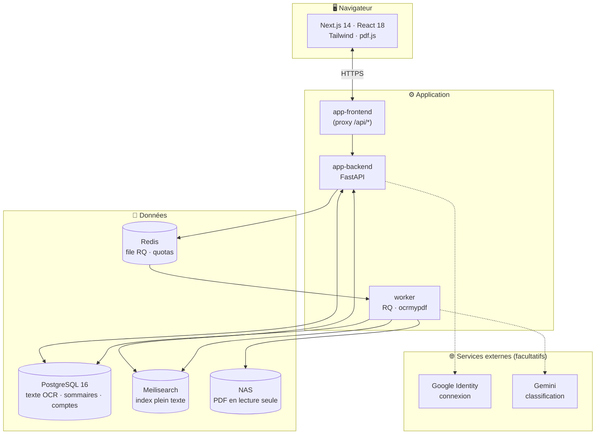
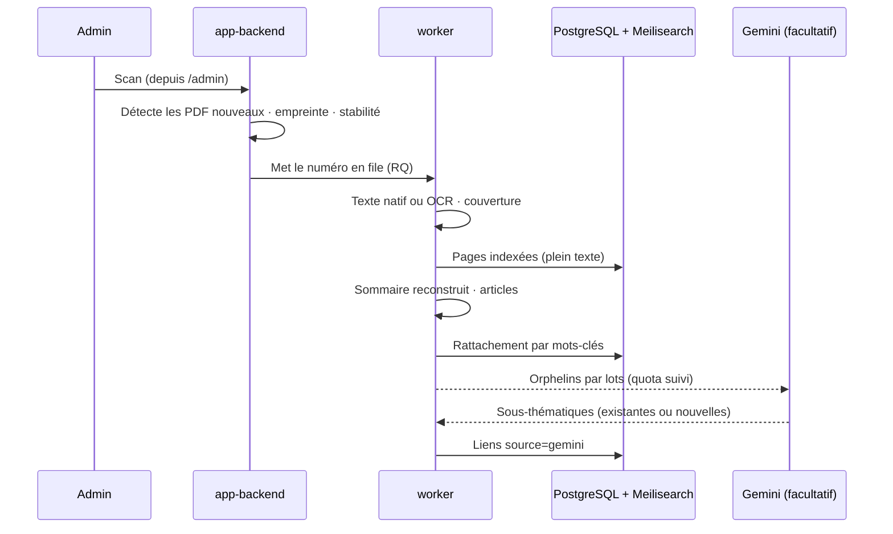

<div align="center">

# 📚 Magazine Search

**Bibliothèque de magazines PDF — recherche plein texte · lecture surlignée · sommaires · thématiques**

[](https://github.com/djkix/magazine-search/releases)
[](#stack-technique)
[](./LICENSE)

*Retrouvez « ponceuse excentrique » dans des milliers de numéros, auto-hébergé, sans rien saisir.*

<br />

```
┌─────────────────────────────────────────────────────────────────────────┐
│  L'Archive                                          🔍 ponceuse excentr…│
├──────────┬──────────────────────────────────────────────────────────────┤
│          │  12 numéros · 3 collections                                  │
│ Recherche│  ─────────────────────────────────────────────────────────── │
│ Biblio   │  Système D n°871 · Mars 2019         ████████ 14 occurrences │
│ Sommaires│  Maison & Travaux n°302 · Mai 2021   ████░░░░  6 occurrences │
│ Thèmes   │  Bricolage Pratique n°45 · Juin 2017 ██░░░░░░  3 occurrences │
│ Admin    │                                                              │
│          │  Clic → le PDF s'ouvre à la bonne page, termes surlignés     │
│          │  OCR · Sommaires reconstruits · Partage par lien · PWA       │
└──────────┴──────────────────────────────────────────────────────────────┘
```

<br />

[Installation](#installation) ·
[Fonctionnalités](#fonctionnalités) ·
[Architecture](#architecture) ·
[Déploiement Docker](#déploiement-docker) ·
[Variables d'environnement](#variables-denvironnement)

</div>

---

## Vue d'ensemble

**Magazine Search** transforme un dossier de PDF sur un NAS en bibliothèque consultable. L'application surveille le partage réseau, extrait le texte (OCR pour les scans), indexe tout, et **déduit le reste toute seule** :

| Déduit automatiquement | D'où ça vient |
|------------------------|---------------|
| 📁 **Collection** | Répertoire de premier niveau du NAS |
| 🔢 **Numéro, date, Hors-Série** | Nom de fichier, avec repli sur le texte de couverture |
| 📑 **Sommaire** | Analyse locale de la page de sommaire (aucun service externe) |
| 🧭 **Thématique** | Rattachement par mots-clés, éventuellement complété par Gemini |

**Auto-hébergé** : vos fichiers restent chez vous. Seules deux fonctions, toutes deux facultatives, appellent un service externe : la connexion Google et la classification Gemini.

---

## Fonctionnalités

### 🔍 Recherche
- Plein texte sur **tous** les numéros ; filtres collection, année, numéro, thématique
- Un résultat par magazine, classé par nombre d'occurrences, affiché « magazine · numéro · Mois année »
- Un clic ouvre le PDF à la page concernée, **occurrences surlignées** à leur position exacte

### 📖 Lecture
- Visionneuse **pdf.js** intégrée, recherche dans le document ouvert, retour vers la collection du numéro
- Rendu à la **densité réelle de l'écran** (net sur mobile, même au zoom)

### 📥 Ingestion automatique
- Détection des nouveaux fichiers, **déduplication par empreinte** de contenu, attente de stabilité (un PDF en cours de copie n'est pas ingéré)
- OCR (`ocrmypdf` / Tesseract `fra+eng`) **seulement si nécessaire**
- Texte natif présent mais illisible (police corrompue → « lll Why | | | ») : repéré par la densité de mots courants et refait par OCR complet
- Scan ne relisant que les fichiers nouveaux ou modifiés ; un scan interrompu est récupéré au redémarrage du worker

### 🗂️ Organisation
- **Collections** automatiques ; **tags** créés à la main pour les regrouper (« Bricolage » = Système D + Maison & Travaux)
- Bibliothèque à deux niveaux (collections → numéros), Hors-Séries toujours en bloc distinct, filtres par année

### 📑 Sommaires reconstruits
- Extraction **locale**, sans coût ; plusieurs mises en page reconnues (points de conduite, colonnes, numéro avant/après le titre)
- Échec **tracé et visible** : page introuvable, ou page trouvée mais illisible (le numéro passe alors *en échec*, une absence légitime de sommaire reste *terminé*)
- Marge de maquette (« 607-sommaire.indd ») écartée sans supprimer de vraies rubriques (« MIX », « Q&A », « GT3 RS »)

### 🧭 Thématiques
- Navigation à **trois écrans** : thématique → sous-thématique → articles groupés par collection, ouverts à la page exacte
- Rattachement au niveau de l'**article**, pas du numéro, par correspondance de mots-clés (gratuit, rejouable)
- **Taxonomie construite hors ligne** depuis le tableau de bord : télécharger le corpus → le soumettre à un modèle → déposer le `.json` → **simulation** (rien n'est écrit tant que vous n'avez pas cliqué *Appliquer*). Import **cumulatif**
- Aussi disponible en CLI : `python tools/importer_sous_thematiques.py`
- Les **articles non rattachés** et leurs mots les plus fréquents sont listés pour compléter la taxonomie

#### 🤖 Classification automatique Gemini *(facultatif)*
- Avec `GEMINI_API_KEY`, les nouveaux articles qu'aucun mot-clé n'attrape sont envoyés à Gemini **par lots** : rangés dans une sous-thématique existante, ou **nouvelle sous-thématique créée** sous une thématique existante
- L'app **compte ses propres requêtes** (minute, jour, tokens) et s'arrête **avant** les limites (2 requêtes/jour en réserve)
- Quota atteint, clé ou modèle refusé : **bandeau sur le tableau de bord** avec la raison et l'heure de reprise (heure locale) ; reprise automatique, y compris après redémarrage
- Les liens posés par Gemini ne sont pas effacés par un recalcul des mots-clés

### 🔗 Partage par lien
- Bouton « Partager » **mobile uniquement**, sur chaque article et chaque couverture : ouvre le partage système (WhatsApp, Messages…)
- Lien public **sans compte**, lecture en **streaming par plages HTTP** (jamais un téléchargement complet)
- Aperçu enrichi (titre, collection, couverture) dans WhatsApp et consorts
- ⚠️ **Pas d'expiration ni de révocation** ; un lien d'article donne accès au magazine entier. Pensé pour un canal privé

### 🔐 Authentification
- **Email + mot de passe** : comptes créés par l'administrateur depuis `/admin` (par défaut, rien à configurer)
- **Google** (si `GOOGLE_CLIENT_ID` est défini) : ⚠️ **n'importe quel compte Google peut créer un accès et lire toute la bibliothèque**. À n'activer que si l'accès est contrôlé en amont
- Fusion automatique par email entre compte manuel et compte Google ; désactiver un compte bloque les deux méthodes
- Aucune notification d'inscription : surveiller le compteur **« Nouveaux comptes (7j) »** du tableau de bord

### 📱 PWA
- Manifeste + icônes : « Ajouter à l'écran d'accueil » (mobile) ou installation depuis la barre d'adresse (desktop)

### 🛠️ Administration
- Tableau de bord auto-rafraîchi, compteurs cliquables par statut, progression page par page, journaux filtrables par niveau/composant, gestion des comptes
- **Relances ciblées**, avec deux actions aux coûts très différents pour les numéros sans sommaire :

| Action | Ce qu'elle fait | Durée |
|--------|-----------------|-------|
| **Réextraire les sommaires** | Rejoue le parsing sur le texte déjà extrait (ni OCR ni appel externe) | Quelques minutes pour toute la bibliothèque |
| **Relancer l'OCR complet** | Refait le traitement de zéro (confirmation demandée) | ~1 min par numéro |

---

## Architecture



### Flux d'ingestion d'un numéro



---

## Stack technique

| Couche | Technologies |
|--------|--------------|
| Backend | Python 3.12, FastAPI, SQLAlchemy 2.0, Alembic, Pydantic v2 |
| Frontend | Next.js 14 (App Router), React 18, Tailwind CSS, pdf.js |
| Base de données | PostgreSQL 16 |
| File d'attente | RQ (Redis Queue) |
| Recherche | Meilisearch |
| OCR | `ocrmypdf` / Tesseract (`fra+eng`) |
| Thématiques | Mots-clés locaux ; Gemini en option (`google-genai`) |
| CI/CD | GitHub Actions → GHCR (`ghcr.io/djkix/magazine-search-*`), release-please |
| Orchestration | Docker Compose |

---

## Installation

### Prérequis
- **Docker** + Docker Compose
- Un **partage réseau** (NAS) contenant vos PDF, un répertoire par magazine

### Déploiement Docker

```bash
git clone https://github.com/djkix/magazine-search.git
cd magazine-search

cp .env.example .env
# Éditer .env : JWT_SECRET_KEY, MEILI_MASTER_KEY, POSTGRES_PASSWORD, NAS_MOUNT_PATH

docker compose up -d
```

Ouvrir `http://<IP-du-serveur>:3000`, se connecter avec le compte d'amorçage (`ADMIN_BOOTSTRAP_EMAIL` / `ADMIN_BOOTSTRAP_PASSWORD`, à vider ensuite), puis **déposer les PDF dans le NAS et lancer un scan depuis `/admin`**.

| Service | Port | Rôle |
|---------|------|------|
| `app-frontend` | 3000 | Interface web + proxy `/api/*` (**seul port publié**) |
| `app-backend` | 8000 *(interne)* | API FastAPI |
| `worker` | — | OCR, sommaires, classification |
| `postgres` · `redis` · `meilisearch` | — | Données, file d'attente, recherche |
| `db-backup` | — | Dump compressé quotidien avec rotation |

> Le reverse proxy n'a besoin que du port du frontend. Les migrations Alembic s'exécutent au démarrage ; si l'une échoue, le conteneur attend `MIGRATION_FAILURE_DELAY_SECONDS` avant de sortir (pas de boucle de redémarrage serrée).

### Développement local

```bash
# Backend (tests)
cd backend
python -m venv .venv && source .venv/bin/activate
pip install -r requirements.txt -r requirements-dev.txt
pytest -q

# Frontend
cd frontend
npm install
npm run dev          # http://localhost:3000
npm run typecheck    # tsc --noEmit
```

Les mêmes contrôles tournent dans GitHub Actions : détection de secrets (gitleaks), typage frontend, ruff, pytest, **rejeu de toute la chaîne Alembic** (up / down / up sur base vierge) et build de l'image.

### Revenir à une version précédente

Chaque release publie un tag d'image `X.Y.Z` (en plus de `latest`). Épingler la version dans `.env` :

```bash
IMAGE_TAG=0.36.2
```

puis `docker compose up -d`. Un rollback de code ne défait pas une migration déjà appliquée : restaurer le dump correspondant si le schéma a changé.

---

## Sauvegarde et restauration

La base PostgreSQL est la **seule donnée non reconstructible** (texte OCR, sommaires, thématiques, comptes). Les PDF du NAS peuvent être re-scannés.

```bash
ls -lh ./backups                    # sauvegardes disponibles
docker compose restart db-backup    # sauvegarde immédiate
```

**Restauration**

```bash
docker compose stop app-backend worker

gunzip -c ./backups/magazines_<horodatage>.sql.gz \
  | docker compose exec -T postgres psql -U "$POSTGRES_USER" -d postgres

docker compose start app-backend worker
```

> Placez `BACKUP_DIR` sur un autre support que le volume PostgreSQL et **testez une restauration périodiquement**. Aucune sauvegarde n'est prise automatiquement avant une migration : pour une migration risquée, faire un dump manuel.

---

## Variables d'environnement

Référence complète et commentée : [`.env.example`](.env.example). L'application **refuse de démarrer** si une variable obligatoire manque, est trop courte ou reste à une valeur d'exemple.

| Variable | Obligatoire | Secret | Description |
|----------|-------------|--------|-------------|
| `JWT_SECRET_KEY` | ✅ | 🔒 | 32 caractères minimum (`openssl rand -hex 32`). Le changer déconnecte tout le monde |
| `MEILI_MASTER_KEY` | ✅ | 🔒 | 16 caractères minimum |
| `POSTGRES_PASSWORD` | ✅ | 🔒 | À générer aléatoirement |
| `NAS_MOUNT_PATH` | ✅ | Non | Chemin hôte du partage, monté en **lecture seule** |
| `FRONTEND_PORT` | Non | Non | Port publié (défaut `3000`) |
| `IMAGE_TAG` | Non | Non | Version déployée (préférer un tag précis à `latest`) |
| `ADMIN_BOOTSTRAP_EMAIL` / `_PASSWORD` | Non | 🔒 | Compte créé au premier démarrage si aucun admin n'existe ; à vider ensuite |
| `GOOGLE_CLIENT_ID` | Non | Public | Active « Se connecter avec Google » (lu au runtime par le backend) |
| `GEMINI_API_KEY` | Non | 🔒 | Active la classification automatique |
| `GEMINI_MODEL` | Non | Non | Modèle (défaut `gemini-3.8-flash`) ; un nom erroné s'affiche sur le tableau de bord |
| `GEMINI_RPM` / `GEMINI_TPM` / `GEMINI_RPD` | Non | Non | Limites de votre compte (défaut 5 · 250 000 · 20), à reprendre d'AI Studio |
| `GEMINI_TIMEOUT_SECONDS` | Non | Non | Délai maximum d'un appel (défaut `120`) |
| `OCR_TIMEOUT_SECONDS` | Non | Non | Délai maximum d'`ocrmypdf` (défaut `1500`) |
| `LOGIN_RATE_LIMIT` | Non | Non | Limite de connexion par IP (défaut `5/15minutes`) |
| `LOGIN_LOCKOUT_MAX_FAILURES` · `_WINDOW_MINUTES` · `LOGIN_LOCKOUT_MINUTES` | Non | Non | Verrouillage par compte (défaut 10 échecs en 15 min → 15 min ; `0` échec = désactivé) |
| `TRUSTED_PROXY_HOPS` | Non | Non | Proxys de confiance ajoutant une entrée à `X-Forwarded-For` (défaut `1` : NPM) |
| `FRONTEND_BIND` | Non | Non | Interface hôte où publier le frontend (défaut `0.0.0.0`) |
| `LOG_TIMEZONE` | Non | Non | Fuseau des journaux (défaut `Europe/Paris`) |
| `BACKUP_DIR` · `BACKUP_RETENTION_DAYS` | Non | Non | Dossier et rétention (14 j) des sauvegardes |

---

## Structure du projet

```
magazine-search/
├── .env.example              # Modèle de configuration (copier → .env)
├── docker-compose.yml
├── backend/
│   ├── app/
│   │   ├── routers/          # auth, magazines, articles, search, themes, partage, admin…
│   │   ├── services/         # OCR/sommaires, taxonomie, classification Gemini, quotas, streaming
│   │   ├── worker/           # tâches RQ (ingestion, sommaires, classification)
│   │   └── models.py         # Schéma SQLAlchemy
│   ├── alembic/versions/     # Migrations
│   ├── tools/                # CLI : import/export de taxonomie, diagnostic de sommaire…
│   └── tests/
├── frontend/
│   ├── app/                  # Pages : (app)/search, library, themes, admin · partage/[token]
│   ├── components/           # Viewer, bibliothèque, partage, admin
│   └── middleware.ts         # Redirection vers /login hors fichiers statiques et /partage
├── ops/                      # Script de sauvegarde PostgreSQL
├── docs/superpowers/         # Spécifications et plans de conception
└── .github/workflows/        # CI, build d'images, release-please
```

---

## API principale

Routes publiques : `/api/health`, la connexion et `/api/partage/*`. **Toutes les autres exigent une session** (cookie `httpOnly`) ; `/api/admin/*` exige le rôle administrateur.

| Méthode | Route | Description |
|---------|-------|-------------|
| `GET` | `/api/health` | Statut *(public)* |
| `POST` | `/api/login` | Connexion email *(public)* |
| `GET` | `/api/auth/google/client-id` | Client ID Google, lu au runtime *(public)* |
| `POST` | `/api/auth/google` | Connexion Google (jeton ID vérifié côté serveur) *(public)* |
| `POST` | `/api/logout` · `GET` `/api/me` | Déconnexion · utilisateur courant |
| `GET` | `/api/search` | Recherche plein texte |
| `GET` | `/api/magazines` · `/{id}` · `/facets` · `/count` | Numéros, filtres |
| `GET` | `/api/magazines/{id}/file` · `/cover` · `/download` | PDF (plages HTTP), couverture, téléchargement |
| `GET` | `/api/magazines/{id}/articles` · `/pages/{n}` | Sommaire, texte d'une page |
| `POST` | `/api/magazines/{id}/share` · `/api/articles/{id}/share` | Crée (ou renvoie) le lien de partage |
| `GET` | `/api/collections` · `/api/tags` | Bibliothèque, tags |
| `GET` | `/api/themes/taxonomie` · `/{id}/subthemes` · `/subthemes/{id}/articles` | Navigation thématique |
| `GET` | `/api/partage/{token}` · `/file` · `/cover` | Article partagé *(public)* |
| `GET` | `/api/partage/magazine/{token}` · `/file` · `/cover` | Numéro partagé *(public)* |
| `GET` | `/api/admin/stats` · `/classification` · `/logs` | Tableau de bord, état Gemini, journaux **(admin)** |
| `POST` | `/api/admin/scan` · `/scan/retry-failed` | Lancer / relancer un scan **(admin)** |
| `POST` | `/api/admin/magazines/reprocess-no-sommaire` · `/reocr-no-sommaire` | Réextraire les sommaires / refaire l'OCR **(admin)** |
| `GET/POST` | `/api/admin/themes/export` · `/orphans/export` · `/import` | Taxonomie hors ligne **(admin)** |
| `GET/POST/PATCH/DELETE` | `/api/admin/users` · `/tags` · `/collections` · `/articles` | Gestion **(admin)** |

### Limites de débit

| Portée | Limite |
|--------|--------|
| `/api/login` · `/api/auth/google`, par adresse IP | 5 / 15 min (`LOGIN_RATE_LIMIT`) |
| `/api/login`, par email visé (toutes IP confondues) | 10 échecs / 15 min → compte verrouillé 15 min (`LOGIN_LOCKOUT_*`) |

L'adresse IP est lue à **droite** de `X-Forwarded-For` : l'entrée ajoutée par Nginx Proxy Manager (`$proxy_add_x_forwarded_for`, réglage par défaut de NPM), pas celle qu'un client peut forger. Le proxy `/api/*` de Next.js transmet l'en-tête sans y ajouter d'entrée. Si un autre proxy ajoutant une entrée est placé devant NPM (Cloudflare…), passer `TRUSTED_PROXY_HOPS` à `2`. Le port du frontend ne doit être joignable **que par NPM** (pare-feu, ou `FRONTEND_BIND`) : un client qui le contacterait directement choisirait lui-même cet en-tête.

Les messages d'erreur affichés dans l'interface sont volontairement courts : la trace complète est dans la page **Journaux** (admin).

---

## Périmètre actuel

**Inclus** — voir [Fonctionnalités](#fonctionnalités) : ingestion OCR, recherche surlignée, sommaires, thématiques à deux niveaux, classification Gemini, partage par lien, Google, PWA, sauvegardes.

**Limites connues**
- Certaines maquettes restent hors de portée : les mensuels qui composent leurs numéros de page en gros caractères décoratifs (presse musicale anglophone) ne laissent aucun chiffre dans le texte reconnu
- Les articles déjà orphelins avant l'activation de Gemini ne sont classés qu'au scan suivant
- Les liens de partage n'expirent pas et ne se révoquent pas

**Hors périmètre** (volontairement)
- Thémage **par numéro** via Gemini (retiré : le quota gratuit rendait l'opération irréaliste)
- Notifications d'inscription (email, webhook) ; liste blanche d'emails pour Google

---

## Historique des versions

Généré automatiquement à chaque release par release-please. **Historique complet : [`CHANGELOG.md`](./CHANGELOG.md).** La version affichée dans l'interface, sous le logo, est celle de la dernière release publiée.

### v0.37.0
- Thématiques : **classification automatique** des nouveaux articles orphelins par Gemini, avec suivi de quota, pauses et reprise affichées sur le tableau de bord

### v0.36.2
- Visionneuse : rendu à la densité réelle de l'écran (plus de pixellisation au zoom sur mobile)

### v0.36.1
- Partage : `pdf.worker.min.mjs` et les fichiers statiques ne sont plus redirigés vers `/login` (lecture cassée pour un visiteur sans session)

### v0.36.0
- **PWA** : manifeste et icônes, application installable

### v0.35.0
- Admin : compteur « Nouveaux comptes (7j) » sur le tableau de bord

---

## Licence

[MIT](./LICENSE)
